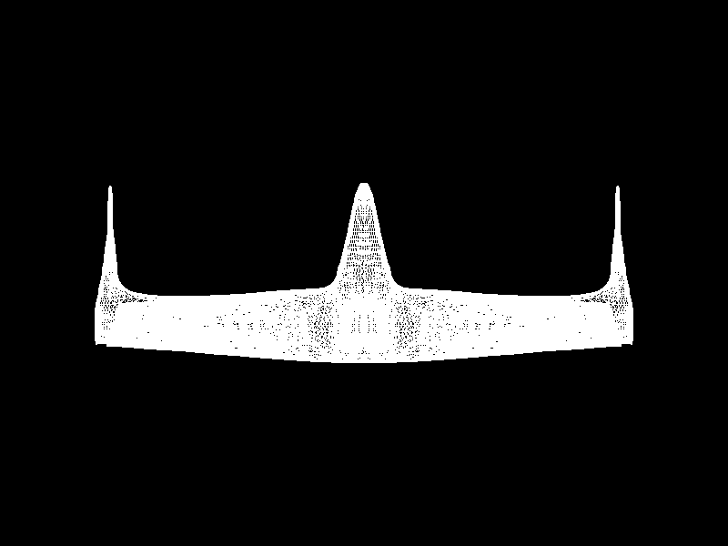

# Lab 4: Carga de modelos

Carga un modelo OBJ y dibuja todos sus triángulos con la función `triangle`
del renderer. Parte del código del laboratorio de relleno de triángulos.



## Cómo se corre

```bash
cargo run --release                     # ventana: 1, 2 y 3 cambian el modo
cargo run --release -- --export-image   # guarda la imagen en docs/modelo.png
cargo test                              # pruebas del cargador OBJ
```

Teclas en la ventana:

| Tecla | Modo |
|---|---|
| `1` | `Wireframe` (por defecto) |
| `2` | `FilledBarycentric` |
| `3` | `FilledScanline` |

## Modelo

[`assets/nave_graficas.obj`](assets/nave_graficas.obj), una nave hecha en
Blender:

| | Cantidad |
|---|---:|
| Vértices (`v`) | 19 833 |
| Caras (`f`) | 39 168 |
| Triángulos dibujados | 39 168 |

## Cómo funciona

1. `Obj::load` (`src/obj.rs`) lee el archivo línea por línea y guarda los
   vértices (`v`), normales (`vn`), coordenadas de textura (`vt`) y las caras
   (`f`). Cada cara se guarda como triángulos de tres índices; si una cara
   tiene más de tres vértices se divide en abanico. Los índices del OBJ
   empiezan en 1 y pueden ser negativos, por eso se convierten a índices
   desde 0.
2. `Obj::vertex_array` recorre todos los triángulos. Para cada uno toma sus
   tres índices y busca los tres vértices correspondientes.
3. El pipeline del renderer hace el resto:
   - **vertex shader**: multiplica cada vértice por la matriz del modelo;
   - **ensamblaje de primitivas**: agrupa los vértices de tres en tres;
   - **rasterización**: llama a `triangle` con cada triángulo;
   - **fragment shader**: pinta cada fragmento en el framebuffer.

No se usa ninguna función de Raylib para cargar o dibujar modelos; Raylib solo
muestra el framebuffer en la ventana.

## Escala y posición

Todavía no hay proyección 3D. La matriz del modelo (`fit_to_screen` en
`src/main.rs`) toma las coordenadas del OBJ y las lleva directo a pantalla:

- Se calcula la caja que contiene a todos los vértices.
- Se escala para que el modelo ocupe como máximo el 80% de la ventana, sin
  deformarlo.
- Se traslada para que el centro de la caja quede en el centro de la ventana.

La nave se dibuja vista desde arriba: la `x` del OBJ es la `x` de pantalla y
la `z` es la `y`. Usando `x` y `y` directamente se veía de frente y solo
aparecía una silueta en forma de X. La `z` se invierte para que la punta de la
nave apunte hacia arriba.
